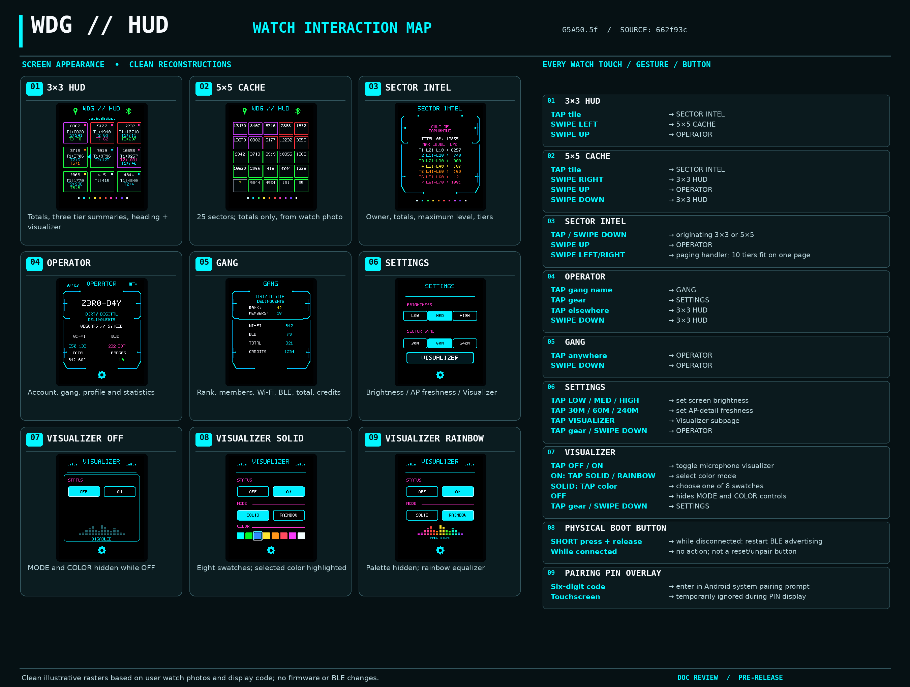

# WDGHeadsUp — ESP32-S3 watch firmware

This is the **full watch firmware project**, not an overlay to copy onto an older development sketch. Build it from the checked-in repository without restoring earlier ZIP patches.

**Hardware:** Waveshare ESP32-S3 Touch AMOLED **2.06-inch** watch/development board, 410 × 502 CO5300 AMOLED, ESP32-S3, touch controller and supported onboard peripherals. The current `platformio.ini` specifies 32 MB flash, 8 MB PSRAM and `default_16MB.csv` partition configuration. Treat that file as authoritative rather than substituting older Arduino IDE or PlatformIO settings.

## Build and upload (Windows PowerShell)

Install VS Code + PlatformIO, USB driver if needed, and a data-capable USB cable. From the repository root:

```powershell
cd .\WDGHeadsUp
pio run -e esp32-s3-devkitc-1
pio run -e esp32-s3-devkitc-1 -t upload
```

If upload cannot find a port, inspect Windows Device Manager and choose the actual COM port:

```powershell
[System.IO.Ports.SerialPort]::GetPortNames()
pio run -e esp32-s3-devkitc-1 -t upload --upload-port COM29
```

`COM29` is a **historical example**, not a guaranteed port. The watch must be powered on; a USB charging-only cable will not work for flashing. Avoid holding BOOT when resetting unless entering a deliberately required download mode.

## Tests

```powershell
pio test -e native
```

The native environment needs a working host C++ compiler, and native tests do **not** validate watch drivers, actual touch hardware, radio encryption, or the AMOLED display. Always follow up with the physical watch checks in [`../docs/TESTING.md`](../docs/TESTING.md).

## Watch interaction map



[One-page PDF](../docs/images/watch-interaction-map.pdf) · [Complete user guide](../docs/USER_GUIDE.md)

## Navigation and behavior

- The **3×3** sector HUD is the default power-on screen.
- Swipe **left** from 3×3 for the **5×5** cached inspection screen; swipe **right** to return.
- Tap a sector to open **Sector Intel**; tap or swipe down to return to the originating grid. The actual 5×5 watch layout shows AP totals only.
- Swipe **up** to OPERATOR. Tap the gang name for **GANG** (tap anywhere to return), or tap the gear for **SETTINGS**. Swipe down to exit secondary pages. There is **no separate touch-accessible MEMBERS screen**.
- SETTINGS includes LOW/MED/HIGH brightness and AP freshness **30M / 60M / 240M** (default **60M**). VISUALIZER opens a separate page with OFF/SOLID/RAINBOW and a selectable color palette only in SOLID mode.
- If BLE is disconnected, a short **BOOT/GPIO0** press can retry BLE advertising. Do not treat it as a reset button or press it while deliberately booting into download mode.

**Persistence:** The watch stores validated last-good sector/OPERATOR state and a GANG summary in NVS. Data is intended to remain visible after BLE loss or reboot. Android supplies the latest data and authenticated profile updates; the watch does not contact WDGWars directly.

**BLE advertising name:** `WDG HUD`. Initial pairing uses a dynamically generated six-digit PIN displayed on the watch and Android system pairing prompt; an already bonded phone should reconnect without repeating it. See the [User Guide](../docs/USER_GUIDE.md).

**Developer references:** `src/main.cpp`, `src/BleTransport.cpp`, `src/Display.cpp`, `src/Touch.cpp`, `src/GeoSectorCache.cpp`, `src/LastGoodStore.cpp`, and [`docs/WATCH_DISPLAY_GEOMETRY.md`](docs/WATCH_DISPLAY_GEOMETRY.md). The display-geometry document contains native screen geometry and preserved, approved layouts.

**Known caveat:** Some old development-only serial commands and member-roster drawing code remain compiled for diagnostics; they are not part of the intended touch UI. Do not re-enable discarded user-facing screens without an explicit product decision.
