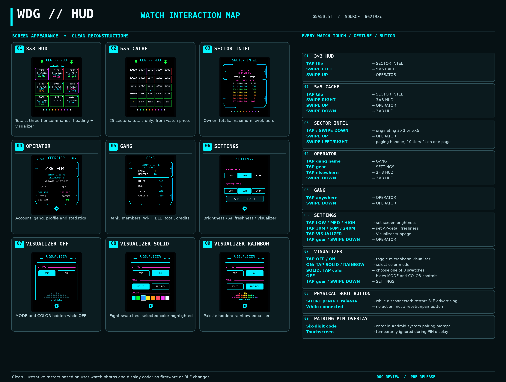

# User guide — WDG // HUD

> **Documentation baseline:** G5A50.5f, Git commit [`662f93c`](https://github.com/zomgwaffles/WDG-HUD/commit/662f93c) (2026-11-19). This is a **pre-release** user guide, not a declaration that public v1.0 acceptance is complete. See [Release checklist](RELEASE_CHECKLIST.md).

WDG // HUD is an **offline-first watch display** for [WDGWars](https://wdgwars.pl/). It consists of the **Waveshare ESP32-S3 Touch AMOLED 2.06-inch watch** and an **Android companion**. The phone provides GPS, WDGWars access, sector caching, and authenticated Bluetooth Low Energy (BLE) synchronization. The watch displays the last validated information even during temporary BLE, GPS, or network interruptions.

**Important:** The watch does **not** perform Wi-Fi/Bluetooth wardriving by itself, fetch WDGWars data directly, or claim to detect the APs shown on its grid. AP totals and tiers come from WDGWars sector data supplied by Android.

## 1. Start here

1. [Install the watch firmware and Android companion](INSTALLATION.md). Both are required for live updates.
2. In Android **WDGWARS ACCESS**, enter and verify your own WDGWars API key. Sign in through the WDGWars website dialog if the authenticated sector-detail session requires it.
3. Enable phone Bluetooth and location services. Pair with the BLE device **WDG HUD** using the temporary six-digit code shown on the watch in the Android **system pairing dialog**.
4. Confirm Android **DRIVING SESSION → SESSION ACTIVE** and that the watch receives GPS and sector updates. Successful BLE connection normally starts the driving session.
5. After the first validated sync, the watch can display retained data offline. Unknown sectors may remain marked `?` until fetched successfully.

Do not force-stop the companion during a drive; Android's foreground service handles background GPS/BLE when the Activity is not visible.

## 2. Watch interaction map

[Full-resolution one-page PDF](images/watch-interaction-map.pdf)

| Screen | Open / action | Return |
| --- | --- | --- |
| **3×3 HUD** | Default; **tap any sector** → SECTOR INTEL; **swipe left** → 5×5; **swipe up** → OPERATOR | **Swipe down** keeps/returns to 3×3 |
| **5×5 CACHE** | From 3×3 swipe left; **tap any sector** → SECTOR INTEL; **swipe up** → OPERATOR | **Swipe right** → 3×3; **swipe down** → 3×3 |
| **SECTOR INTEL** | Tap any square in 3×3 or 5×5. Horizontal swipes enter the detail-page handler; the current 10-tier view fits on one page. | **Tap** or **swipe down** → originating 3×3/5×5; **swipe up** → OPERATOR |
| **OPERATOR** | **Swipe up** from a grid. **Tap gang name** → GANG; **tap gear** → SETTINGS. | **Tap elsewhere** or **swipe down** → 3×3 |
| **GANG** | **Tap gang name** on OPERATOR; rank, members, Wi-Fi, BLE, total, credits | **Tap anywhere** or **swipe down** → OPERATOR; no BACK button |
| **SETTINGS** | **Tap LOW/MED/HIGH**, **30M/60M/240M**, or the **VISUALIZER** button | **Tap bottom gear** or **swipe down** → OPERATOR |
| **VISUALIZER** | **OFF/ON**; when ON choose **SOLID/RAINBOW**; in SOLID tap one of **8 swatches** | **Tap bottom gear** or **swipe down** → SETTINGS |
| **Physical BOOT** | Short press and release (60–1200 ms) **while disconnected** retries BLE advertising. While connected: no action. | Not a reset/unpair button |
| **Pairing PIN overlay** | Watch shows six-digit code for Android **system Bluetooth pairing** dialog | Watch touch navigation is temporarily disabled until pairing completes |

There is no separate user-facing **MEMBERS** screen. Use touch controls only when safely stopped, not while driving.

## 3. 3×3 driving HUD and 5×5 cache inspection

### 3×3 driving HUD

- The grid is **north-up**: rows represent surrounding geographic sectors, not the direction the vehicle faces.
- The **middle square** represents the phone's GPS-selected sector. Each square's **large white number** is its AP total.
- `T2:350`, for example, means **350 APs in hardness tier 2**. A populated 3×3 square displays **up to three tiers with the greatest AP counts**. The tiny upper-right marker identifies the **highest hardness tier present**, which need not be the most common.
- The **square outline** represents WDGWars gang ownership using the supplied gang color. A neutral grey or unknown square is not proof of an unclaimed or zero-AP sector.
- The **cyan direction triangle** indicates the most recently accepted GPS **course over ground**. It is not a magnetic compass and may not update while stationary.
- Tap a square to open **SECTOR INTEL** for that location.

The grid can also show **CACHED // TOTALS ONLY** when geographic totals are available but the associated tier/ownership detail is not. Do not interpret that fallback as a complete live sector-detail scan.

### 5×5 cache inspection

- Swipe **left** from 3×3 to display the **same GPS-centered 25-sector window**.
- Each populated square displays its **AP total only** in the currently accepted watch layout. The 5×5 view does **not** display tier labels or per-tier counts; tap a sector for SECTOR INTEL.
- `?` means the sector has **no validated cached record**. A recorded `0` represents a **confirmed zero-AP** sector; neither should be confused with an API error.
- The center square has a small cyan **notch**. All 25 cells share the same underlying geographic cache as the 3×3 HUD.
- Opening 5×5 **does not start a new scan**, request a 7×7 window, or change the GPS-selected center. The Android companion independently manages refreshes and its cumulative sector history.
- Tap a square for **SECTOR INTEL**, or swipe right to return to 3×3.

**Sector geometry:** WDGWars sectors are indexed on a **0.02° latitude × 0.02° longitude** grid. Sector-boundary checks can use saved/calculated coordinates without requesting boundary data from the internet on every GPS fix. Physical east-west dimensions vary with latitude.

## 4. OPERATOR, GANG and SECTOR INTEL

**OPERATOR** is a last-good account snapshot. It displays the operator callsign, optional activity-rank description when available, gang name, profile sync status, and reported Wi-Fi/BLE/total/badges values. Tap the **gang name** to open **GANG**, or the bottom **gear** for SETTINGS. The clock and battery status remain part of the OPERATOR display.

**GANG** is one information screen: gang name/color, rank, member count, Wi-Fi, BLE, total, and credits. **Tap anywhere** to return to OPERATOR. GANG is not a member-roster browser.

**SECTOR INTEL** displays the chosen sector's gang, AP total, maximum recorded level, and populated hardness-tier breakdown. For example, `T1 L01-L10` covers levels 1–10, while `T10 L91+` covers the highest bucket. Tap to return to whichever grid opened the sector.

Values in the illustrations are **examples**, not a capture of a real player's profile, gang, or sector.

## 5. SETTINGS and VISUALIZER

### SETTINGS

| Setting | Choices | Effect |
| --- | --- | --- |
| **BRIGHTNESS** | **LOW / MED / HIGH** | Changes watch display brightness; saved across restart |
| **SECTOR SYNC** | **30M / 60M / 240M** | Sets minimum age for Android **AP-detail refresh eligibility**: 30 minutes, 1 hour, or 4 hours |
| **VISUALIZER** | Opens subpage | Configures watch microphone visualizer presentation |

**Sector Sync is a freshness threshold, not an automatic network request every N minutes.** Only missing/stale eligible AP-detail records are candidates for refresh when connectivity and the companion's scheduling permit. Failed or interrupted refreshes must not delete a previously validated value. **Gang ownership, GANG information and Operator/profile refresh policies remain separate, with a one-hour minimum**; the watch's 30M option does not lower those limits.

The watch stores the interval and sends an authenticated BLE setting such as `CFG:STALE,30` to a compatible Android companion. The **private RC6** companion supports all three presets; older RC5 installations do not support 30M. Watch-to-Android 30M/60M notification handling was observed in maintainer logs; a full multi-hour expiration test and 240M log proof remain separate validation items.

### VISUALIZER

| State | Display and controls |
| --- | --- |
| **OFF** | Only STATUS **OFF / ON** appears; MODE and COLOR disappear. The screen shows a muted `DISABLED` equalizer indicator. |
| **ON / SOLID** | Shows STATUS, MODE **SOLID / RAINBOW**, and the color palette. The **selected swatch has a visible white/cyan outline**. |
| **ON / RAINBOW** | Shows STATUS and MODE. The color palette is **hidden** and a static, multicolored equalizer illustration is shown on the Settings page. |

Selected buttons use **dark text on a cyan fill**; unselected buttons use **white text on dark backgrounds**. Section headings are magenta. The setting labels do **not** change text color with the selected visualizer color. The watch stores Visualizer ON/OFF, mode, and chosen solid color persistently.

The equalizer on the **settings page** is an illustrative mode indicator. Actual microphone-driven animation occurs on the watch HUD when enabled and supported by the audio hardware.

## 6. What stays visible when offline?

- **Android** maintains persistent, cumulative geographically keyed sector history. Re-entering a previously visited area should reuse saved records before or while any eligible refresh runs.
- The **watch** restores validated last-good geographic snapshots from nonvolatile storage after restart. Switching 3×3/5×5 views does not clear those records.
- OPERATOR/GANG data uses **account-scoped last-good storage** and an authenticated account-owner handshake. Cross-account **A → B → A hardware acceptance** is still a release gate; do not describe this as independently field-certified isolation.
- GPS fixes, phone internet, BLE connection, and remote responses may be temporarily unavailable. The watch should preserve last-good validated data, not replace it with fabricated zeros merely because a refresh failed.
- A missing sector, a stale-but-valid sector, and a confirmed **zero-AP** sector are different states. The freshness interval determines **when to request**, not **how long data remains visible**.

## 7. Android companion reference

| Panel/control | Purpose |
| --- | --- |
| **WATCH UPLINK** | Watch BLE state, connection health, GPS packet counts, reconnect controls |
| **DRIVING SESSION** | Foreground/background driving-session status; normally starts after watch connection; STOP is available |
| **SECTOR MATRIX / 3×3** | Automatic sector status and background prefetch; the retired manual 3×3 Sync button is not part of the accepted UI |
| **GPS TELEMETRY** | GPS source, position, speed and accepted course/bearing |
| **WDGWARS ACCESS** | Your API key verification and website session sign-in |
| **OPTIONAL // PUBLIC PROFILE CARD** | Optional public SVG card URL for your own account; not an API key |

The Android app's login session and private API key serve different functions. Never include the API key, website cookies, pairing PIN, or precise private routes in public bug reports.

## 8. Pairing, reconnection, and troubleshooting

| Symptom | Checks / expected behavior |
| --- | --- |
| **No watch connection** | Keep phone nearby; ensure Bluetooth/permissions; use Android **RECONNECT WATCH**. When the watch is disconnected, a short watch **BOOT** press can request BLE advertising again. It is not a factory reset or general unpair command. |
| **Pairing prompt fails** | Use the **Android system prompt** and the watch's current temporary six-digit PIN. Do not enter a hardcoded PIN. |
| **Connected, no new sectors** | Check **SESSION ACTIVE**, GPS telemetry, WDGWars API-key verification and website login. Cached data can remain visible while new requests are unavailable. |
| **Unknown `?` sectors** | A record has not yet been validated; do not treat it as zero AP. Prefetch can fill the slot later. |
| **Wrong arrow direction** | Course over ground is meaningful while moving; it is not a stationary compass heading. |
| **Saved data disappears after reinstall** | Uninstalling or clearing Android storage is destructive. Prefer compatible **in-place upgrades** for retention testing; do not erase watch flash/NVS to troubleshoot normal sync delays. |
| **Switching WDGWars accounts** | Account-scoped transfers exist, but full two-account hardware acceptance remains pending. Report any previous-account values with redacted logs; do not clear NVS as a workaround. |

**Driving safety:** Stop the vehicle before using menus, tapping Sector Intel, pairing, entering credentials, or troubleshooting. Use the grid only for brief safe glances.

### About the illustrations

The approved interaction map is a **2700 × 2040 digital illustration**, built from actual user-provided watch photographs and the G5A50.5f display/touch code. Data in the graphic are examples or retained photo values, not live account values. It is **not a pixel-identical hardware screenshot**. The visual map and this guide agree on **left from 3×3 → 5×5** and **right from 5×5 → 3×3**. For authoritative geometry, see [Watch display geometry](../WDGHeadsUp/docs/WATCH_DISPLAY_GEOMETRY.md).
